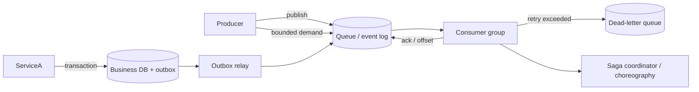

# Module 8 — Messaging & Asynchronous Communication

A source-linked, runnable Java 21 learning module. Each roadmap topic has its own directory with a guide, standalone example, and focused JUnit tests. Examples are local simulations—no broker, database, cloud account, or credential is required.

## Roadmap coverage map

| Roadmap topic | Explicit subtopics | Topic folder | Guide | Runnable example | Tests |
|---|---|---|---|---|---|
| Message Queues | RabbitMQ; SQS | [`topics/message-queues/`](topics/message-queues/) | [guide](topics/message-queues/README.md) | [example](topics/message-queues/src/main/java/Example.java) | [tests](topics/message-queues/src/test/java/ExampleTest.java) |
| Event Streaming | Kafka; Google Pub/Sub | [`topics/event-streaming/`](topics/event-streaming/) | [guide](topics/event-streaming/README.md) | [example](topics/event-streaming/src/main/java/Example.java) | [tests](topics/event-streaming/src/test/java/ExampleTest.java) |
| Pub/Sub Pattern | Pub/Sub Pattern | [`topics/pub-sub/`](topics/pub-sub/) | [guide](topics/pub-sub/README.md) | [example](topics/pub-sub/src/main/java/Example.java) | [tests](topics/pub-sub/src/test/java/ExampleTest.java) |
| Message Ordering & Exactly-Once Delivery | Message Ordering; Exactly-Once Delivery | [`topics/delivery-semantics/`](topics/delivery-semantics/) | [guide](topics/delivery-semantics/README.md) | [example](topics/delivery-semantics/src/main/java/Example.java) | [tests](topics/delivery-semantics/src/test/java/ExampleTest.java) |
| Dead Letter Queues | Dead Letter Queues | [`topics/dead-letter-queues/`](topics/dead-letter-queues/) | [guide](topics/dead-letter-queues/README.md) | [example](topics/dead-letter-queues/src/main/java/Example.java) | [tests](topics/dead-letter-queues/src/test/java/ExampleTest.java) |
| Saga Pattern | Orchestration; Choreography | [`topics/saga/`](topics/saga/) | [guide](topics/saga/README.md) | [example](topics/saga/src/main/java/Example.java) | [tests](topics/saga/src/test/java/ExampleTest.java) |
| Outbox Pattern | Outbox Pattern | [`topics/outbox/`](topics/outbox/) | [guide](topics/outbox/README.md) | [example](topics/outbox/src/main/java/Example.java) | [tests](topics/outbox/src/test/java/ExampleTest.java) |
| Backpressure Handling | Backpressure Handling | [`topics/backpressure/`](topics/backpressure/) | [guide](topics/backpressure/README.md) | [example](topics/backpressure/src/main/java/Example.java) | [tests](topics/backpressure/src/test/java/ExampleTest.java) |
## Architecture



The diagram is conceptual; every topic guide distinguishes the model from the limits of its in-memory example.

## Run and test

Requires a Java 21 toolchain (Gradle can use an installed JDK or a configured toolchain resolver).

```sh
./gradlew test
./gradlew runExample -Pexample=<fully-qualified-class-from-topic-guide>
./gradlew runAllExamples
```

Each topic guide provides its example’s exact fully qualified class name; package names are descriptive and need not mirror the directory name. Tests are intentionally offline apart from resolving the pinned JUnit dependency the first time Gradle runs.

## Trade-offs and anti-patterns

Assume network failures and duplicate delivery. Use durable state, idempotent consumers, explicit retries and DLQ ownership, stable event schemas, and bounded concurrency. Ordering and exactly-once effects require carefully scoped guarantees.

- Avoid selecting a technology before identifying consistency, latency, durability, failure, and operational requirements.
- Avoid hiding stale reads, duplicate delivery, unbounded work, or schema changes behind a “best effort” abstraction.
- Examples are educational models, not production-ready clients or claims of vendor equivalence; follow the linked product documentation for configured guarantees.

## References

Topic guides link directly to primary vendor documentation and, where appropriate, a foundational paper/specification. Product behavior is version- and configuration-dependent; verify guarantees against the deployed version.
